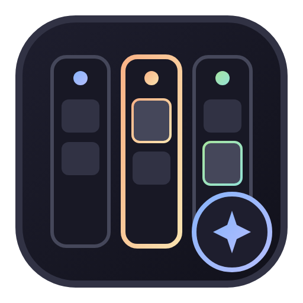

<p align="center">
  
</p>

# agy-github-worker-board

[](https://github.com/rrivera/agy-github-worker-board)
[](https://antigravity.google)

Live auxiliary-pane sidecar status board for agent-ready GitHub issue workflows in Antigravity.

Companion UI plugin to [**`rrivera/agy-github-worker`**](https://github.com/rrivera/agy-github-worker).

---

## Overview

`agy-github-worker-board` runs as an Antigravity sidecar in the auxiliary side pane, providing real-time visibility into your GitHub issue automation without polluting the agent's context or spending tokens:

- **Live Kanban Cards**: Displays stacked horizontal cards categorized across **Todo**, **In Progress**, **Waiting on User**, and **In Review**.
- **Action Status Badges**: Identifies required attention at a glance (`NEEDS_PLAN`, `USER_REPLIED`, `NEEDS_REVISION`, `WAITING_ON_USER`).
- **Direct GitHub Navigation**: Clickable links to issues, labels, and linked pull requests with author and diff status.
- **Dynamic Search & Filtering**: Real-time client-side filter by issue title, number, labels, action status, or PR.
- **Zero Token Overhead**: Operates entirely out-of-band via the GitHub CLI (`gh`), automatically refreshing every 30 seconds and reacting to workspace focus changes.

---

## Relationship with `agy-github-worker`

| Package | Purpose | Installation |
| :--- | :--- | :--- |
| [**`agy-github-worker`**](https://github.com/rrivera/agy-github-worker) | **Core Skill**: Autonomous execution engine (`/github-worker`), TDD cycles, 3-axis peer reviews. | Required for autonomous issue execution. |
| [**`agy-github-worker-board`**](https://github.com/rrivera/agy-github-worker-board) | **Companion UI**: Real-time visual auxiliary pane status board. | Optional companion for visual status tracking. |

---

## Directory Structure

```text
agy-github-worker-board/
├── plugin.json                              # Antigravity plugin manifest
├── package.json                             # Root test runner & project definition
├── README.md                                # Documentation
├── assets/
│   ├── logo.svg                             # Plugin icon (vector)
│   └── logo.png                             # Plugin icon (rendered PNG)
└── sidecars/
    └── github-worker-board/
        ├── sidecar.json                     # Antigravity sidecar definition
        ├── package.json                     # Sidecar dependencies & test runner
        ├── main.mjs                         # Backend HTTP server & GitHub CLI data fetcher
        ├── index.html                       # Sidecar webview layout
        ├── styles.css                       # Antigravity-matching Catppuccin theme
        ├── app.js                           # Webview reactivity & DOM renderer
        └── test/
            ├── app.test.mjs                 # Unit tests for UI rendering & logic
            └── main.test.mjs                # Unit tests for server & API pipeline
```

---

## Installation in Antigravity

Clone into your Antigravity global plugins directory:

```bash
mkdir -p ~/.gemini/config/plugins
git clone https://github.com/rrivera/agy-github-worker-board ~/.gemini/config/plugins/agy-github-worker-board
```

Restart or reload Antigravity. The board will appear in the auxiliary side pane, automatically detecting the repository of your active workspace.

---

## Testing

Run the test suite from the repository root:

```bash
npm test
```

All 50 unit and integration tests are executed using Node's native test runner (`node --test`).

---

## License

MIT
